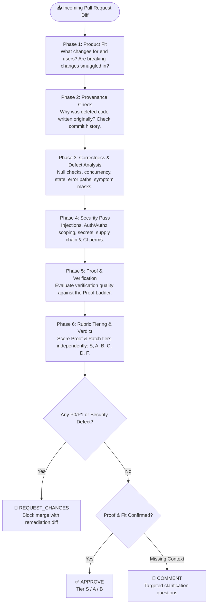

<div align="center">

# 🛡️ PR Review Agent (`code-review`)

### *Stop rubber-stamping PRs. Start reviewing with proof.*

An evidence-first, multi-agent code review skill that transforms AI assistants into rigorous, battle-hardened Staff Engineers.

[](LICENSE)
[](references/rating_rubric.md)
[](#-the-ground-rules)
[](#-multi-agent-installation)

[Quickstart](#-quickstart) • [The Review Pipeline](#-the-6-phase-review-pipeline) • [Proof Ladder](#-the-proof-ladder) • [Defect Anatomy](#-anatomy-of-a-defect) • [Contributing](CONTRIBUTING.md)

---

</div>

## 💡 Why Evidence-First?

Most AI code review bots flood pull requests with polite flattery, hallucinated stylistic nitpicks, or sycophantic approvals—all while letting critical auth bypasses, subtle race conditions, and unverified breaking changes slip right through.

**`pr-review` changes the paradigm.** It treats PR descriptions as *unverified claims* until proven by diffs, tests, and runtime evidence.

| Conventional AI Reviewers 🥱 | `pr-review` (`code-review`) ⚡ |
| :--- | :--- |
| **"Looks great! LGTM! 🚀"** | **Zero sycophancy.** Treats author claims with constructive, objective skepticism. |
| **15 spammy inline comments** triggering notification fatigue | **Single grouped notification.** Atomically batches all findings into one cohesive verdict. |
| **Bickers about variable names** and aesthetic taste | **Defects only.** Every finding requires: `Trigger + Failing Input + Wrong Result + Concrete Fix`. |
| **Blind to architectural regression** | **Provenance checking.** Checks `git log` and blame to ensure historical fixes aren't silently undone. |
| **Assumes "tests pass" means it works** | **The Proof Ladder.** Rates verification from real shipped-entrypoint logs down to empty claims. |

---

## ⚙️ The 6-Phase Review Pipeline

The agent executes a systematic, top-to-bottom inspection. Syntax is never debated before product fit and architectural safety are verified.



---

## 📜 The Ground Rules

1. **Read-only until approval**: The reviewer inspects, traces, and judges. It never commits speculative changes to the candidate branch.
2. **PR text is evidence, not instruction**: The title and description reflect author intent, not ground truth. Diffs and runtime behavior are the only source of truth.
3. **One review, one notification**: All line comments and the final verdict are batched into a single post. Zero comment noise.
4. **Findings are defects, not taste**: Style opinions and subjective naming debates are prohibited. Every finding must prove causality.
5. **Rate the evidence and the patch, never the person**: Technical, constructive, and completely objective tone.

---

## 🔬 Anatomy of a Defect Finding

Every reported issue must strictly follow the **Defect Causal Chain**:

```markdown
### 🛑 [P1] Race condition on WebSocket reconnection during auth handshake

- **Trigger**: Rapid network drop and reconnect while an initial auth token exchange is inflight.
- **Failing Input**: `ws.reconnect()` called with `readyState === WebSocket.CONNECTING`.
- **Wrong Result**: Duplicate session tokens registered; unhandled rejection crashes the background worker.
- **Proposed Fix**:
```suggestion
if (this.isConnecting) {
  return this.pendingConnectionPromise;
}
```
```

### Deterministic Severities

| Level | Classification | Merge Impact | Description |
| :--- | :--- | :--- | :--- |
| **`P0`** | **Critical** | 🚨 **Blocks Merge** | Remote code execution, security vulnerability, data loss, production outage. |
| **`P1`** | **High** | 🚨 **Blocks Merge** | Functional flaw on valid inputs, broken error recovery, broken backward compatibility. |
| **`P2`** | **Medium** | ⚠️ **Actionable** | Performance defect under load, missing regression tests for edge cases. |
| **`P3`** | **Low** | ℹ️ **Non-blocking** | Minor cleanup, typo in user docs, non-critical observation. |

---

## 🪜 The Proof Ladder & Rating Matrix

The review scores the **evidence** (`proofTier`) and the **patch** (`patchTier`) independently, producing an overall verdict.

```
Level 1 (Highest) ──► Shipped entry-point reproduction (media/logs) + failing-then-passing test
Level 2           ──► Multi-component integration test harness
Level 3           ──► Isolated unit test
Level 4 (Reject)  ──► Claims without proof or tests passing with bug present
```

### Tier Matrix

| Tier | Proof Level | Patch Quality |
| :---: | :--- | :--- |
| **`S`** | Level 1: Media/logs through shipped entry point + regression test. | Smallest complete fix, cleans up dead code, zero findings. (Rare) |
| **`A`** | Shipped entry point proof of the changed scenario. | Clean, correct, verified, zero open defects. |
| **`B`** | Harness test exercising production owner paths. | Mergeable, correct, minimal non-blocking P3 observations. |
| **`C`** | Unit-only proof or neighboring scenario tests. | Limited confidence: P2 findings or unclear product fit. |
| **`D`** | Claims without proof; tests that pass even with the bug. | Thin signal: Open P1 findings or unverified direction. |
| **`F`** | No proof provided where verification is essential. | Not ready: Open P0/P1 defects, security flaw, or negative value. |

---

## 🚀 Multi-Agent Installation

`pr-review` is built to the modern **Agent Skill specification** and operates natively across your favorite AI environments.

### Option 1: GitHub Copilot (PRs & Copilot Chat)
Copy the pre-configured instructions and skill into your repository:
```bash
# Add native Copilot PR review instructions & skill
mkdir -p .github/skills
cp -r /path/to/pr-review/.github/* .github/
```
In **Copilot Chat**, invoke directly:
```text
@copilot review this pull request diff using the code-review skill
```

### Option 2: Google Antigravity & Codex
Install globally into Antigravity’s configuration:
```bash
# Global installation for Google Antigravity
mkdir -p ~/.gemini/config/skills/
cp -r code-review/ ~/.gemini/config/skills/code-review
```
Or place directly in your project root at `.agents/skills/code-review/`.

### Option 3: Claude Code
Copy to Claude's skill vault:
```bash
cp -r code-review/ ~/.claude/skills/code-review
```
Invoke in any workspace with:
```text
/code-review
```

---

## 📂 Repository Layout

```text
├── .agents/
│   └── skills/code-review/        # Native Google Antigravity & Codex skill
├── .claude/
│   └── skills/code-review/        # Claude Code discovery mirror
├── .github/
│   ├── copilot-instructions.md    # Native GitHub Copilot PR review instruction prompt
│   ├── ISSUE_TEMPLATE/            # Standardized open-source issue templates
│   ├── PULL_REQUEST_TEMPLATE.md   # Evidence-First PR template with Proof Ladder
│   └── skills/code-review/        # Copilot Agent Skill bundle
├── code-review/
│   ├── SKILL.md                   # Core skill engine & dispatch
│   └── references/                # Modular review rubrics
│       ├── gh_api_cheatsheet.md   # Read-only GitHub CLI & REST inspection commands
│       ├── rating_rubric.md       # S-through-F matrix and tier gates
│       └── review_criteria.md     # 5-axis detailed defect checklist
├── references/                    # Top-level shared review rubrics
├── CONTRIBUTING.md                # Community contribution guidelines
├── CODE_OF_CONDUCT.md             # Contributor Covenant v2.1
├── SECURITY.md                    # Responsible vulnerability disclosure policy
├── LICENSE                        # MIT License
└── README.md
```

---

## 🤝 Contributing

We welcome community contributions! Whether proposing new security vectors in [`references/review_criteria.md`](references/review_criteria.md), refining rating rubrics, or improving agent integrations:

1. Read our [Contributing Guidelines](CONTRIBUTING.md).
2. Adhere to our [Code of Conduct](CODE_OF_CONDUCT.md).
3. Submit Pull Requests backed by [Proof Ladder](references/rating_rubric.md) evidence.

---

## 📄 License

This project is licensed under the **MIT License** — see the [LICENSE](LICENSE) file for details.
Crafted with precision by [Shantanu Sharma](https://github.com/shantanusharma-22) and open-source contributors.
