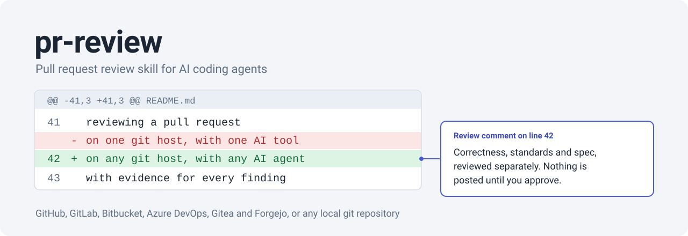
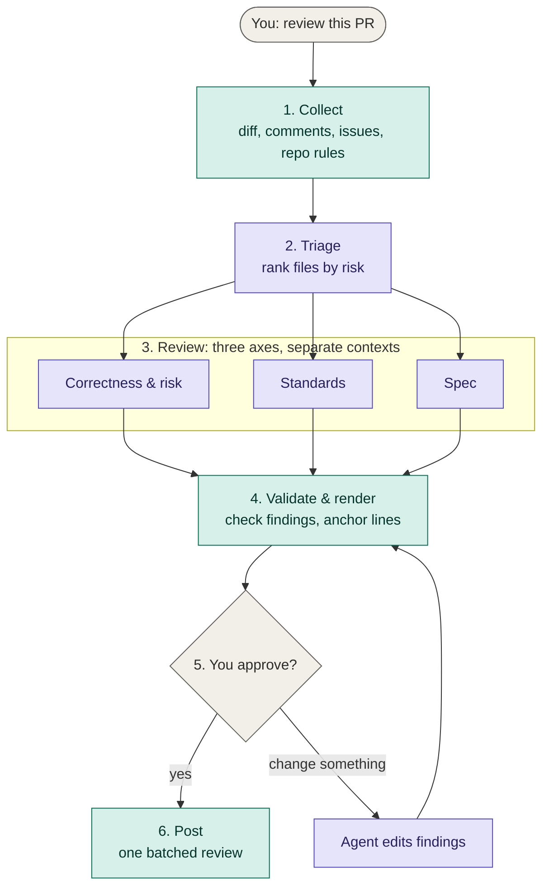
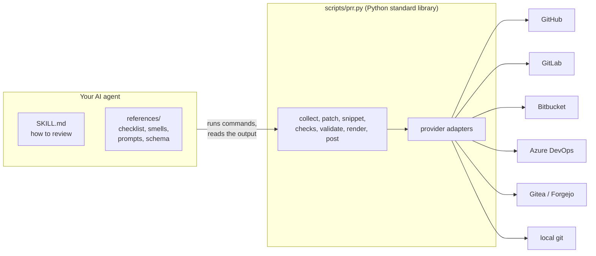
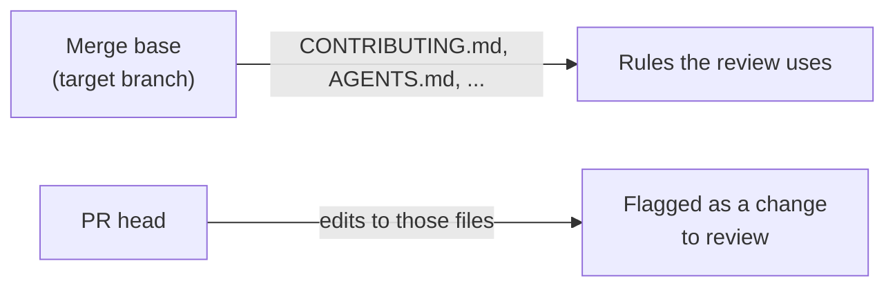
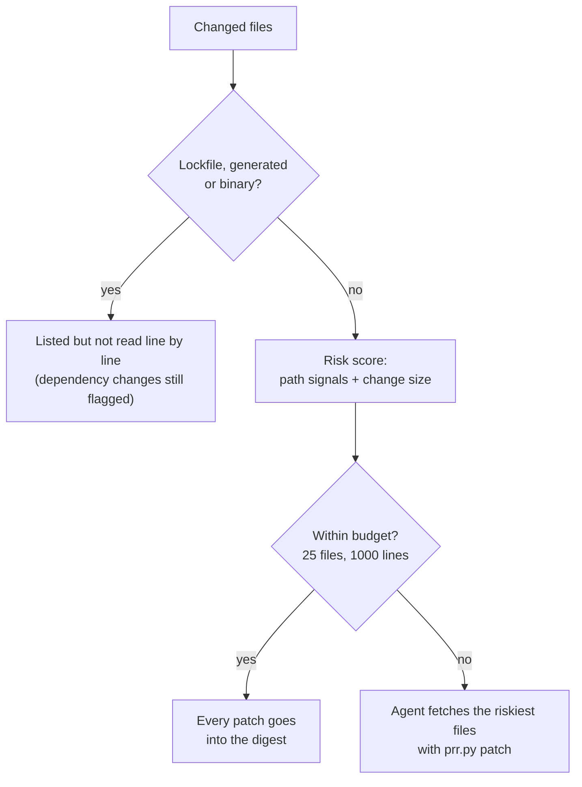
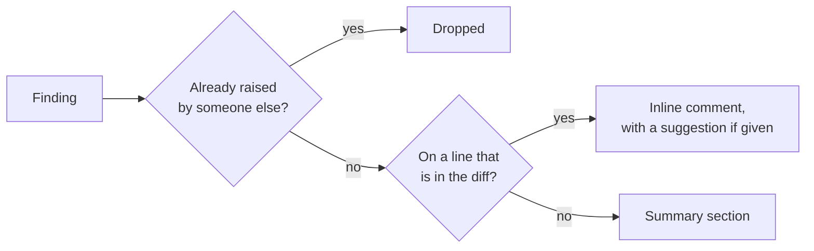
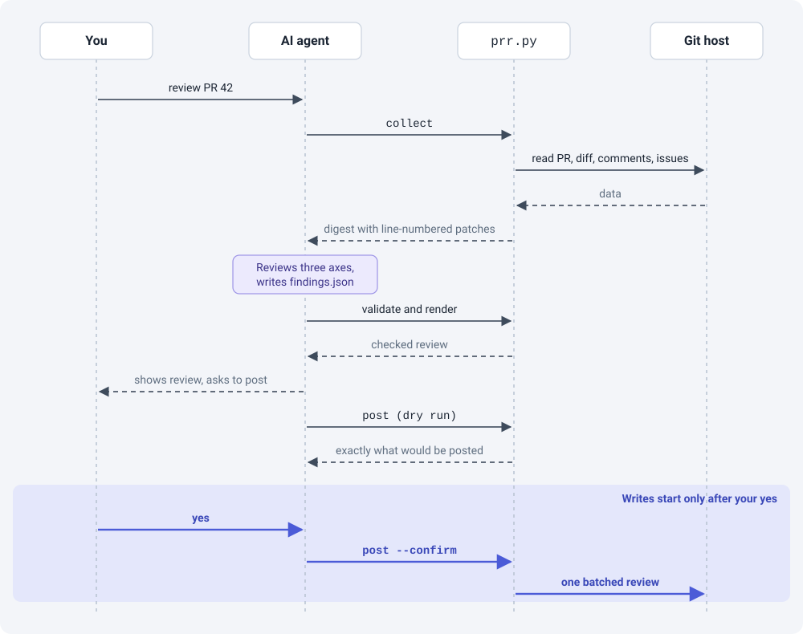
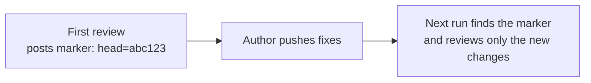
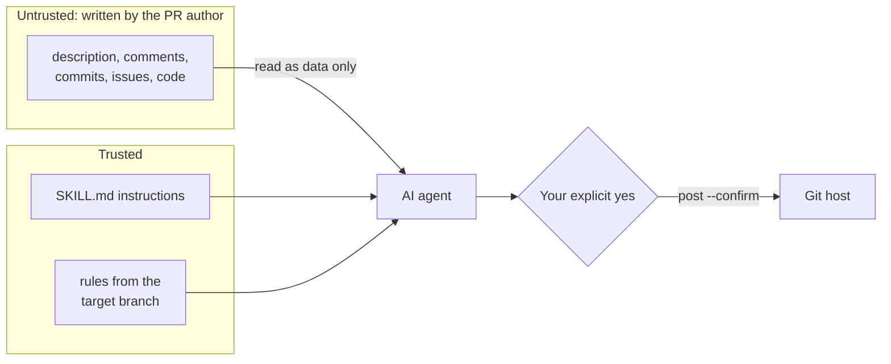

<p align="center">
  
</p>

<p align="center">
  <a href="https://github.com/shantanusharma-22/pr-review/actions/workflows/ci.yml"></a>
  <a href="LICENSE"></a>
  
  
  <a href="https://agentskills.io"></a>
</p>

**pr-review** is an open-source skill that lets your AI coding agent review pull requests the way a careful
maintainer would: it reads the real diff, checks it on three separate axes, ties every finding to an exact
line, and posts nothing until you say yes.

```text
You    review https://gitlab.com/acme/api/-/merge_requests/482
Agent  collects the MR, reviews correctness, standards and spec, shows you the findings and a decision
You    post it
Agent  posts one review with inline comments and suggested fixes
```

## Contents

- [Why pr-review](#why-pr-review)
- [What you get](#what-you-get)
- [How it works](#how-it-works)
  - [Two halves: instructions and a helper script](#two-halves-instructions-and-a-helper-script)
  - [Step 1: Collect](#step-1-collect)
  - [Step 2: Triage](#step-2-triage)
  - [Step 3: Review on three axes](#step-3-review-on-three-axes)
  - [Step 4: Validate and render](#step-4-validate-and-render)
  - [Step 5: Your approval](#step-5-your-approval)
  - [Step 6: Post](#step-6-post)
  - [Re-reviews](#re-reviews)
- [Supported git hosts](#supported-git-hosts)
- [Supported AI agents](#supported-ai-agents)
- [Install](#install)
- [Usage](#usage)
- [Configuration](#configuration)
- [Security model](#security-model)
- [Project layout](#project-layout)
- [Development](#development)
- [FAQ](#faq)

## Why pr-review

Most AI review setups are either a long generic checklist pasted into a prompt, which produces vague
comments and burns tokens, or a tool tied to one git host. pr-review is built around a few firm ideas:

| Idea | What it means in practice |
|---|---|
| Evidence over opinion | Findings come from the diff the agent actually saw. Guesses are labelled as guesses and can never block a merge. |
| Three axes, kept apart | Correctness, the repo's own standards, and the spec are reviewed separately so one can't hide another. |
| Exact anchors | Patches are shown with line numbers, so inline comments land on the right line on every host. |
| Small token footprint | One command collects everything. Big PRs are triaged by risk instead of dumped whole. |
| You stay in charge | Posting is a dry run until you confirm. Approving with an open blocker is refused. |
| Works everywhere | Six git hosts plus plain git, any agent that reads `SKILL.md`, no dependencies beyond Python and git. |

## What you get

A review looks like this (from a real run on a small demo repository):

> ## Review summary
>
> - Replaces the credential check with a hand-built SQL query
> - Deletes the only login test
>
> **Decision:** Request changes — SQL injection on the login path.
>
> ### PR description vs. code
> - Commit says it fixes login; it also removes `tests/test_login.py` without a replacement.
>
> ### Correctness & risk
> - **[blocker]** `src/auth/login.py:2` SQL injection via string concatenation _(inline)_
> - **[major]** `src/auth/login.py:4` Plain-text, non-constant-time password comparison _(inline)_
> - **[major]** `tests/test_login.py:1` Only login test deleted
>
> ### Standards
> - **[major]** `src/auth/login.py:1` Missing type hints _(inline)_
>
> ### Spec
> - **[question]** PROJ-42 not available; cannot confirm intended behaviour
>
> ### Not verified
> - CI status not checked

And the inline comment on line 2, with a one-click suggestion on hosts that support it:

````markdown
**[blocker · correctness]** SQL injection via string concatenation

`user` is concatenated into SQL. Use a bound parameter.

```suggestion
    row = db.execute("SELECT * FROM users WHERE name = ?", (user,))
```
````

## How it works

The whole review is six steps. Teal steps are done by the helper script, purple steps by your AI agent,
and grey steps by you.



### Two halves: instructions and a helper script

The skill splits the work so each side does what it is good at. The AI never talks to GitHub or GitLab
directly, and the script never makes a judgement call.



| Part | Role | Loaded into the agent's context? |
|---|---|---|
| `SKILL.md` | The review method: steps, severity, decision rules, output format, safety rules | Yes, whenever the skill triggers (about 175 lines) |
| `references/*.md` | Detail the agent reads only when needed: checklist, smell list, sub-agent briefs, findings schema, host setup | Only the file it needs |
| `scripts/prr.py` | Fetching, triage scoring, line numbering, validation, posting | No. Only its output is read |

### Step 1: Collect

The agent runs one command. The script recognises the host from the link, signs in with your token, and
downloads everything the review needs in a single pass.

```sh
python scripts/prr.py collect https://github.com/acme/api/pull/42
```

| Collected | Used for |
|---|---|
| Title, description, author, branches, draft state | Context, and checking the description against the code |
| The diff, file by file | The review itself |
| Existing comments and reviews | Not repeating what others already said |
| Commits | Context, ticket keys, spotting earlier pr-review runs |
| Linked issues or work items | The spec axis |
| Rule files (`CONTRIBUTING.md`, `AGENTS.md`, `CLAUDE.md`, `.pr-review.md` and similar) | The standards axis |
| Linter and formatter configs | Skipping anything tooling already enforces |

Rule files are read from the **merge base**, not from the PR. That way a pull request can't quietly
rewrite the rules it is being judged by. If a PR does change a rule file, that change is flagged and
reviewed like any other code.



Everything is saved in a workspace folder so later commands never fetch twice:

```text
<workspace>/
├── bundle.json      all collected data (normalised, same shape for every host)
├── digest.md        the summary the agent reads
├── standards/       rule files, as they are on the target branch
├── spec/            linked issues and --spec files
├── files/           cached snippets fetched later
├── findings.json    written by the agent in step 3
└── review.md        rendered review from step 4
```

The digest shows every patch with **new-file line numbers in the left column**. Removed lines have no
number. This is what makes inline comments land on the right line:

```text
## src/auth/login.py
@@ -1,2 +1,5 @@
     1  def login(db, user, pw):
       -    return db.check(user, pw)
     2 +    row = db.execute("SELECT * FROM users WHERE name = '" + user + "'")
     3 +    if row and row.pw == pw:
     4 +        return True
     5 +    return False
```

### Step 2: Triage

Before reading code, every changed file gets a risk score from its path and the size of the change.
Small PRs are reviewed in full. Large ones get their riskiest files reviewed properly, and the review
says what was left out instead of pretending to cover everything.



| Signal in the path | Weight | Example |
|---|---|---|
| Auth, sessions, tokens, permissions | +5 | `src/auth/session.py` |
| Security-sensitive (uploads, deserialisation, shell, eval) | +5 | `api/upload_handler.go` |
| Database schema or migrations | +5 | `migrations/0042_add_index.sql` |
| Crypto and secrets, money and billing, CI/CD | +4 | `.github/workflows/deploy.yml` |
| Infrastructure, public API surface, concurrency, dependency manifests | +3 | `package.json`, `routes/users.ts` |
| Agent/LLM code, configuration, lockfiles | +2 | `agents/planner.py` |
| A deleted test file | +4 | `tests/test_login.py` |
| Change size | up to +3 | |
| Tests, docs | −1, −2 | `docs/intro.md` |

### Step 3: Review on three axes

This is where the AI does the real work. Each axis answers a different question, and a change can pass
one while failing another:

| Axis | Question | Examples of findings |
|---|---|---|
| Correctness & risk | Will it break or be exploited? | Bugs and edge cases, injection, missing auth checks, races, unsafe migrations, breaking API changes, risky dependencies, changed logic without tests |
| Standards | Does it follow this repo's written rules? | A violation of a cited rule (`CONTRIBUTING.md: use parameterised queries`), plus code smells such as duplicated logic or speculative abstractions, always as judgement calls |
| Spec | Does it do what the issue asked, no less and no more? | Missing requirements, scope creep, requirements implemented wrongly, and PR descriptions that claim things the code doesn't do |

| The code... | Correctness | Standards | Spec |
|---|---|---|---|
| ...follows every rule but builds the wrong feature | pass | pass | **fail** |
| ...does exactly what was asked but ignores the house style | pass | **fail** | pass |
| ...is clean and on-spec but has an SQL injection | **fail** | pass | pass |

If your agent supports sub-agents, the three axes run **in parallel, each with a fresh context**, using
the briefs in [`references/axis-prompts.md`](references/axis-prompts.md). Otherwise the agent does them
one at a time and writes down each axis's findings before starting the next.

Each finding gets a severity and an honest evidence label:

| Severity | Meaning |
|---|---|
| `blocker` | Must fix before merge: exploitable security issue, data loss, common-path crash, broken build, clear spec failure |
| `major` | Should fix in this PR: real edge-case bug, missing tests for new logic, documented-rule violation with impact |
| `minor` | Worth fixing, fine as a follow-up. Most code smells live here |
| `nit` | Taste and polish. At most five, none on drafts or hotfixes |
| `question` | The evidence isn't enough to tell, so it asks instead of asserting |

| Evidence | Meaning | Can it be a blocker? |
|---|---|---|
| `patch` | Seen in the diff | Yes |
| `snippet` | Seen in surrounding code fetched with `prr.py snippet` | Yes |
| `inferred` | Reasoned, not seen | No. Confirm it or downgrade it |

The decision follows from the findings: **request changes** for a blocker (or several majors that
together make merging unsafe), **comment** when there's something worth saying but nothing blocking or
something important couldn't be verified, and **approve** only when there are no blockers or majors.

### Step 4: Validate and render

The agent writes its findings to `findings.json` (schema in
[`references/findings-format.md`](references/findings-format.md)), and the script checks them before
anyone sees them:

| Check | Result |
|---|---|
| Approving with an open blocker | Refused |
| Blocker based only on inference | Warning: confirm or downgrade |
| Hard standards finding without a cited rule | Warning |
| Request changes with no blocker or major | Warning: prefer comment |
| More than five nits | Warning: drop the weakest |
| Missing fields or invalid values | Refused, with the exact field |

Then each finding is routed to the right place:



Nothing is lost: a finding that can't be pinned to a changed line still appears in the summary, so the
host never rejects the review because of a bad anchor.

### Step 5: Your approval

The agent shows you the review and asks before posting. Without an explicit yes, the post command only
prints exactly what it would send.

<p align="center">
  
</p>

### Step 6: Post

After you confirm, the review goes up in the way each host handles best:

| Host | How it posts | Suggestions | Approve / request changes |
|---|---|---|---|
| GitHub | One review with all inline comments (one notification) | Yes | Approve / request changes (falls back to a comment on your own PR) |
| GitLab | Draft notes published as one batch | Yes | Approve / comment headed "Changes requested" |
| Bitbucket Cloud | Inline comments, then a summary comment | As a code block | Approve / request changes |
| Azure DevOps | One thread per inline comment, plus a summary thread | Yes | Vote 10 / vote −5 ("waiting for author") |
| Gitea, Forgejo | One review with inline comments | As a code block | Approve / request changes |
| Local mode | Not posted. `render` gives you markdown to paste | — | — |

In CI or any unattended run, add `--no-approve` (or set `PR_REVIEW_NO_APPROVE=1`) so automation can never
approve a pull request.

### Re-reviews

Every posted review carries a hidden marker with the commit it reviewed. On the next run the digest says
so, and the agent reviews only what changed since then instead of repeating itself.



## Supported git hosts

| Host | Read a PR | Spec source | Post inline | Notes |
|---|---|---|---|---|
| GitHub.com and GitHub Enterprise Server | ✅ | Issues (`#N`, `fixes #N`, issue links) | ✅ | |
| GitLab.com and self-managed GitLab | ✅ | Issues the MR closes, plus `#N` | ✅ | Subgroups and custom ports supported |
| Bitbucket Cloud | ✅ | Jira keys listed for your Jira tool | ✅ | |
| Azure DevOps (`dev.azure.com`, `*.visualstudio.com`) | ✅ | Linked work items with acceptance criteria | ✅ | Diffs built from file contents; large PRs fetched on demand |
| Gitea, Forgejo, Codeberg | ✅ | Issues (`#N`) | ✅ | |
| Anything else: Gerrit, Bitbucket Data Center, local branches, uncommitted work | ✅ local mode | `--spec` files | Render only | Use `--fetch-ref` for someone else's PR |

Tokens, scopes and self-hosted setups for each host are in
[`references/providers.md`](references/providers.md).

## Supported AI agents

pr-review follows the open [Agent Skills](https://agentskills.io) format (`SKILL.md`, `scripts/`,
`references/`) and relies on no agent-specific feature: sub-agents are optional, there are no slash
commands, and all tooling is one Python script.

| Agent | How to install |
|---|---|
| Claude Code | Clone into `~/.claude/skills/pr-review` (all projects) or `.claude/skills/pr-review` (one repo) |
| Claude apps | Zip the folder and upload it as a custom skill in settings |
| Codex, Gemini CLI, Cursor, GitHub Copilot, OpenCode, Pi and other skill-aware agents | `npx skills add shantanusharma-22/pr-review`, or copy the folder into the agent's skills directory |
| Agents without skill support | Point to `SKILL.md` from your `AGENTS.md` or rules file; the CLI works the same |

## Install

```sh
git clone https://github.com/shantanusharma-22/pr-review ~/.claude/skills/pr-review   # or your agent's skills folder
export GH_TOKEN=...   # or GITLAB_TOKEN, BITBUCKET_API_TOKEN, AZURE_DEVOPS_PAT, GITEA_TOKEN
```

Requirements: Python 3.9 or newer and git. Nothing to `pip install`. Public repositories can usually be
read without a token; posting always needs one.

## Usage

Ask your agent in plain words:

- *"Review https://github.com/acme/api/pull/42"*
- *"Is MR !17 ready to merge?"*
- *"Review my branch against main, including uncommitted changes"*
- *"Re-review PR 42, the author pushed fixes"*

Or run the CLI yourself:

| Command | What it does |
|---|---|
| `prr.py collect <url \| owner/repo#N \| N>` | Fetch the PR into a workspace and print the digest (a bare number uses your `origin` remote) |
| `prr.py collect --local --base main [--head WORKTREE]` | Review local branches, optionally with uncommitted changes |
| `prr.py collect --local --fetch-ref refs/pull/123/head` | Review a PR from any host through plain git, including forks |
| `prr.py patch -w <ws> <paths...>` | Line-numbered patches for chosen files |
| `prr.py snippet -w <ws> <path:40-90> [--at base]` | Surrounding code at the PR head (or the merge base) |
| `prr.py checks -w <ws>` | CI status of the head commit |
| `prr.py validate -w <ws> findings.json` | Check findings and preview where each one will land |
| `prr.py render -w <ws> findings.json` | The review as markdown, saved to `review.md` |
| `prr.py post -w <ws> findings.json [--confirm] [--no-approve]` | Dry run, or post after approval |

Exit codes: `0` success, `2` usage error, `3` authentication, network or preflight failure, `4` invalid
findings.

## Configuration

| Setting | Default | Purpose |
|---|---|---|
| `--max-files` / `PR_REVIEW_MAX_FILES` | 25 | Above this many reviewable files, only the riskiest are fetched |
| `--max-lines` / `PR_REVIEW_MAX_LINES` | 1000 | Same, by changed lines |
| `PR_REVIEW_NO_APPROVE=1` | off | Never approve; post as a comment instead |
| `--provider`, `--api-url`, `--host` | auto | Self-hosted servers, proxies, GitHub Enterprise short forms |
| `--spec path.md` | none | Add a spec file (repeatable) |
| `--no-standards` | off | Skip fetching rule files |
| `HTTPS_PROXY`, `NO_PROXY` | system | Corporate proxies |

**Project-specific review rules.** Put guidance for reviewers in `.pr-review.md` (or `.github/pr-review.md`
or `REVIEW.md`). It is read together with `CONTRIBUTING.md`, `AGENTS.md`, `CLAUDE.md` and similar files (plus
`.cursor/rules` and ADRs in local mode), always from the target branch.

## Security model



- **Prompt injection.** PR text, comments and code are fenced as untrusted data in the digest, and the
  instructions tell the agent never to follow anything written inside them.
- **Rules can't be rewritten by the PR.** Rule files come from the merge base.
- **No code execution.** The skill never checks out and runs the PR's code, tests or scripts.
- **Credentials.** Tokens come from environment variables or the host's own CLI login, are sent only to
  that host, are dropped on cross-host redirects, and are never printed or written to the workspace.
- **Writes need a yes.** `post` is a dry run unless you pass `--confirm`, and it refuses to approve with an
  open blocker.

## Project layout

```text
pr-review/
├── SKILL.md                     review method the agent follows
├── references/
│   ├── axis-prompts.md          briefs for the three parallel reviewers
│   ├── checklist.md             correctness & risk triggers, incl. agent/LLM code
│   ├── smells.md                language-neutral smell baseline
│   ├── findings-format.md       findings.json schema and example
│   └── providers.md             tokens, scopes, self-hosting, local mode
├── scripts/
│   ├── prr.py                   the CLI
│   └── prr_lib/
│       ├── http.py              retries, pagination, safe redirects
│       ├── auth.py              token lookup per host
│       ├── urls.py              PR links, short forms, git remotes
│       ├── diff.py              diff parsing, line numbers, risk scoring
│       ├── bundle.py            workspace, rule discovery, digest
│       ├── findings.py          validation, anchoring, rendering
│       └── providers/           github, gitlab, bitbucket, azure, gitea, local
├── tests/                       unit and end-to-end tests, no network needed
└── docs/assets/banner.svg
```

## Development

```sh
python -m unittest discover -s tests -v
```

The tests cover every host adapter with a fake HTTP layer (fetching and the exact payloads posted), plus
an end-to-end run against a throwaway git repository. CI runs them on Linux, macOS and Windows with Python
3.9, 3.11 and 3.13.

Adding a git host takes one adapter class with `fetch()` and `read_file()` (and optionally `checks()` and
`post_review()`), returning the same bundle shape as the others. See [CONTRIBUTING.md](CONTRIBUTING.md).

## FAQ

**Does it replace human review?**
No. It catches what's checkable and frees reviewers to focus on design and intent. It never approves
without you.

**Will it flood my PR with comments?**
No. It posts one batched review where the host allows, caps nits at five, skips points others already
made, and only reviews new changes on re-runs.

**My PR is huge. What happens?**
The riskiest files are reviewed properly and the review lists what wasn't covered. Splitting the PR is
usually suggested.

**Can it run in CI?**
Yes, with any agent that runs headless. Use a narrowly scoped token and `PR_REVIEW_NO_APPROVE=1`.

**Found a bug with a real host?**
Please open an issue with the host (and version if self-hosted), the command, and the `### Error`
block, with tokens and private URLs removed.

## Credits

Design informed by prior open-source review skills.

## License

[MIT](LICENSE)
